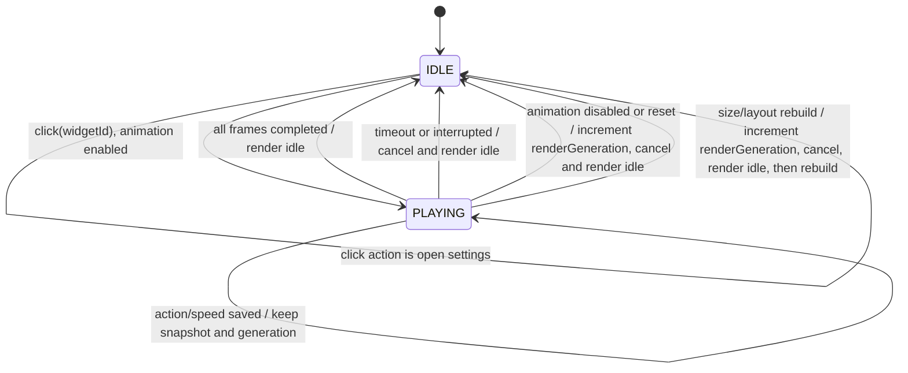

# 咖啡桌宠 Android 实现计划

> 版本：1.2（2026-10-27）
> 状态：P0/P1/P2/P3 已全部通过并交付。Code 3 已安装到目标 Redmi K Pad，保留一个默认小号 1×1 widget；同签升级、真实离线、锁屏/人工 PIN 解锁、真实重启和安装后点击均通过。唯一播放选型为 expedited JobService + 逐帧 RemoteViews 资源引用更新；host advance 实测失败并淘汰。
> 目标设备：红米 K Pad，Android 16/API 36，Xiaomi HyperOS 3.0.310.0.WAOCNXM；HOME `com.miui.home` launcher 4.50.0.1182。真机证据见 [P0 结果报告](android-p0-results.md)。
> 适用范围：自用、离线 Android APK。本文是 Android 开发的唯一实施依据。

## 1. 目标和边界

把现有咖啡猫素材制作为 Android 桌面小部件。用户通常看到静止待机猫；点击默认 widget 猫时随机播放一次完整动作，结束回到静止。设置从应用图标打开，也可由 widget 的设置点击行为打开。保留现有 Windows 版本和目录，不移植 Windows 窗口行为。

需求来源是用户已确认的 Android 需求（R01–R08）。本计划优先于 `outputs/android-feasibility-review.md` 中的旧假设；旧评估只作为本地源码/素材线索，不视为 Android 设备实测。目标机和 launcher 实测决定实现是否通过 P0 选型门。P0 未通过时暂停后续依赖它的功能并报告证据，回到用户/主代理决策；不得默认为循环、纯静态、应用内动画或悬浮窗替代。

## 2. 已确认需求与计划默认行为

| 编号 | 必选要求 |
|---|---|
| R01 | 红米 K Pad、HyperOS 3.0.310.0；底层 Android 版本和实际 launcher 开工时读取记录。自用 APK。 |
| R02 | 只用现有咖啡素材，透明背景只显示猫；平时静止待机。 |
| R03 | 点击默认播放随机一次完整动作；播放中再次点击立即忽略，不重播、不排队；结束回待机。无定时随机动作。 |
| R04 | 小号/大号 widget，用户可调整宠物显示尺寸；尺寸受 launcher 网格与 resize 能力约束。 |
| R05 | 应用图标打开直接进入设置。设置含动画开关、随机/固定动作、速度、大小、点击行为（仅首版“播放动作/打开设置”）、效果预览、恢复默认。每项标明生效时机和作用范围。 |
| R06 | 通常一个实例；支持多个实例并各自独立设置和播放/忙碌状态。 |
| R07 | 无声音、震动、喂食或成长功能。 |
| R08 | 离线运行，素材和设置本地保存，不依赖网络服务。 |


以下 D 项是本计划为实现一致性采用的默认行为，不表示用户逐项确认过这些实现细节：

| 编号 | 计划采用的默认行为 |
|---|---|
| D01 | 普通动作/速度设置变更在下一次动作生效；当前动作使用启动时快照。关闭动画或恢复默认时，取消相关播放并请求立即静止。 |
| D02 | 恢复默认作用于全局默认与全部现存实例，刷新设置和 widget。 |
| D03 | 删除实例时清理该 appWidgetId 的设置、busy 状态与事务；其它实例不受影响。 |
| D04 | widget 尺寸变化或宿主重建时，取消正在播放的动作、显示静止帧，再应用新布局；不得因重绘重新触发动作。 |

**排除范围：** Windows 功能改动；悬浮窗/跨应用覆盖；网络、账号、云同步；自选/导入素材；声音与触觉；自动或定时播放；通知、常驻前台服务、高频精确闹钟；商店发布和商业化。Android 方案不得改变 Windows 使用方式。

## 3. 仓库现状（本轮已核对）

- 基线核对时间：2026-10-26（开始本计划文档编辑前）；当时分支为 `main`、工作区干净。未发现仓库或上级目录适用的 `AGENTS.md`。
- 根目录 README 当前描述 Windows 桌宠与 Windows 构建/发布：[README.md](../README.md)。
- 当前应用是 WPF/C# `net10.0-windows`：[Coffee.Desktop.csproj](../src/Coffee.Desktop/Coffee.Desktop.csproj)。透明无边框置顶窗口：[MainWindow.xaml](../src/Coffee.Desktop/MainWindow.xaml)。Android 是独立工程，不更改这些文件或 Windows 构建脚本。
- 动画源码常量定义帧 192×208、8 列，时间间隔 170 ms；帧数为 `[6,8,8,4,5,8,6,6,6,8,8]`。动作行 0 待机、1/2 左右跑、3 打招呼、4 跳跃、5–8 垂耳/举爪/转头/理爪；9/10 为朝向帧：[MainWindow.xaml.cs](../src/Coffee.Desktop/MainWindow.xaml.cs)。此映射需在素材切片阶段用实际图像复核。
- 本地素材 `assets/spritesheet.png` 已读取元数据：1536×2288 PNG，约 2.44 MB；按 8×11 网格切为 192×208 共 88 格，其中 73 个有效帧。原始文件保留不改；Android 使用裁切后的帧资源，避免每次点击解码整张图。
- 设置页和 JSON 存储是 Windows 专用实现：[SettingsWindow.cs](../src/Coffee.Desktop/SettingsWindow.cs)、[AppSettings.cs](../src/Coffee.Desktop/Models/AppSettings.cs)、[SettingsStore.cs](../src/Coffee.Desktop/Services/SettingsStore.cs)。仅行为语义可参考，Android 设置/持久化需新写。
- 旧可行性评估在 [outputs/android-feasibility-review.md](../outputs/android-feasibility-review.md)。其中“点击 widget 打开设置”等交互与已确认需求不一致；本计划的需求编号和验收矩阵覆盖优先。

## 4. 技术路线与工程结构

### 4.1 建议路线

- 新建独立 `android/` 工程，Kotlin 原生 Android；设置 Activity 使用 Jetpack Compose。
- widget 首选经典 `AppWidgetProvider` + XML `RemoteViews`。不选 Glance 作为动画技术绕行方案：Glance 仍受 App Widget/RemoteViews 宿主模型约束。小部件布局只用 RemoteViews 支持的原生视图。小/大号先以 1×1 与 2×2 launcher 网格占格作为候选，P0 在目标 launcher 核对并记录实际占格与 resize 行为；若需改为不同尺寸规格，按变更规则确认。
- **当前播放建议：** `PlaybackReceiver` 同步调用 coordinator 判 busy 并立即返回；按 widgetId 调度 expedited `JobService`，执行 `PER_FRAME` 逐帧 RemoteViews 预打包资源引用更新，结束提交静帧。
- **历史原型淘汰记录：** host `AdapterViewFlipper` 在 HyperOS 显示系统 widget 错误占位；旧版长时间 `goAsync()` 又导致广播串行迟到。两项历史证据和淘汰理由见 P0 报告，不作为当前方案分支。
- 播放互斥与事务状态按每个 `appWidgetId`（widgetId）隔离。receiver 在同步 `onReceive` 中原子取得 coordinator busy 守卫并立即返回；每实例用独立 jobId 提交 API 31+ expedited `JobService`，不持有整段 `goAsync()`，也不降级为普通排队 job。Job 启动时限 1.5 秒，停止不重试并取消回 idle。`PlaybackJobRunRegistry` 以 `(jobId, transactionId, renderGeneration)` 记录运行，并按 expected-record 移除，避免旧完成/stop 影响替换事务。配置快照和 generation 规则保持原契约。
- 禁止跨进程发送 Bitmap 或整张雪碧图；选定路线仅逐帧传递预打包 drawable 资源引用。不得常驻服务或后台循环；不把周期更新、WorkManager、AlarmManager 或延迟广播当作精确终止时钟。
- 设置数据本地存储：DataStore 或 Room/Preferences 均可；首版简单配置优先 Preferences DataStore。全局设置保存设置页打开入口及默认策略；每实例保存可独立的动作选择/尺寸等偏好及必要的状态版本。数据层封装，便于 P0 后按原型选型调整。
- `minSdk`、`compileSdk`、`targetSdk`、AGP、Kotlin/JDK 版本是开工建议，不在本计划伪称已安装或验证。P0 开始先读取目标设备 Android/API 级别，随后按当时稳定、兼容的工具链锁定并记录版本；`targetSdk` 选择遵循自用安装需求及 Android 行为兼容验证，不为迎合商店规则增加发布工作。

### 4.2 目录草案

```text
android/
  settings.gradle.kts
  build.gradle.kts
  gradle/                 # wrapper 与版本锁定（工程阶段产生）
  app/
    build.gradle.kts
    src/main/AndroidManifest.xml
    src/main/java/.../MainActivity.kt          # 图标入口直达设置
    src/main/java/.../settings/                # Compose UI、设置状态/校验
    src/main/java/.../widget/                  # Provider、RemoteViews、PendingIntent
    src/main/java/.../playback/                # 播放协调器、状态机、P0 选定执行器
    src/main/java/.../data/                    # DataStore 与实例状态仓库
    src/main/res/layout/                       # 小/大 widget 宿主布局
    src/main/res/xml/                           # provider 元数据、备份规则
    src/main/res/drawable-nodpi/                # 裁切并优化的帧资源（或经测定采用密度资源）
    src/test/                                   # 状态机与映射单元测试
    src/androidTest/                            # Activity/provider/存储集成测试
```

包名和签名标识在工程初始化时确定并记录；保持稳定以支持同签名升级。

## 5. 数据、点击与播放状态

### 5.1 设置范围和生效规则

| 设置 | 保存范围 | 生效时间 |
|---|---|---|
| 动画开关 | 全局默认 + 每实例可覆写（首版默认跟随全局） | 立即重绘全部实例；关闭时取消播放并显示待机 |
| 动作模式随机/固定、固定动作 | 每实例；新实例继承全局默认 | 下一次点击；播放中的动作保留启动快照 |
| 速度 | 每实例；新实例继承全局默认 | 下一次动作；不改写正在播放动作的帧时钟 |
| 大小 | 每实例 | 保存后取消播放并显示静止帧，再更新布局/显示；launcher 接受的实际占格由 host 决定（D04） |
| 点击行为 | 每实例；初始默认“播放动作” | 保存后立即生效；可选“打开设置” |
| 预览 | 仅设置页临时状态 | 退出预览即恢复；不改变 widget 播放状态，不落盘 |
| 恢复默认 | 全局默认及全部实例（D02） | 立即取消所有实例播放、恢复默认设置并刷新 widget |

应用图标打开 `MainActivity` 后直接展示设置。widget 设置行为启动同一设置页，并可定位所点 `appWidgetId` 的实例选项。若实例设置页未指明实例则显示全局设置。设置变更采用明确“保存/应用”动作，避免拖动滑杆期间连续更新宿主。

### 5.2 状态机和时序

每实例状态：`IDLE`、`PLAYING(transactionId, renderGeneration, actionSnapshot, speedSnapshot, configVersionSnapshot, startedAt, deadline)`。状态仓库以 widgetId 为键，busy compare-and-set 与事务创建原子提交；动作/速度保存只更新 `nextConfigVersion` 和下一次播放配置，不改当前 transactionId/renderGeneration。正常完成只校验实例存在、transactionId 和 renderGeneration 匹配，然后用原动作快照结束并显示静止帧；设置版本变化不阻断此完成。关闭动画/恢复默认/尺寸布局重建递增 renderGeneration 并取消当前事务；删除实例使存在性校验失败并清理状态。



时序约束（由 P0 在真机验证并为各速度给出容差）：

1. 首次有效点击后尽快启动选定动作；同一 widget 自接受点击直到静态待机已提交期间均视为 busy。
2. busy 点击丢弃，不排队、不改变 transactionId、不重启动作；其它 widgetId 可独立开始。
3. 正常完成必须显示动作最后一帧，然后实际停止推进并显示静止待机；最终画面不能仅靠数据库状态推断。
4. deadline、广播/宿主被中断或进程正常回收后，取消事务并恢复静止；不强制补完动作。重新创建/刷新时，旧 transactionId 的回调不得覆盖当前设置、较新的事务或待机布局。
5. 尺寸变化或布局重建时按 D04 取消当前动作并呈现静止帧，然后应用新布局；新布局只建立 idle 状态，不派发播放事件。
6. 普通动作/速度修改只更新 `nextConfigVersion`，当前动作仍按快照正常完成且回到静止；下次点击才读取新值。尺寸变更导致布局重建是 D04 的例外，递增 `renderGeneration` 并先取消当前动作，避免重绘重复播放。
7. 动画关闭后任何点击都不播放；关闭/恢复默认使相关事务失效并请求立即静止。恢复默认影响所有实例（D02）；实例单独关闭只影响该实例（若 UI 提供覆写）。
8. 应用进程用户强行停止后，Android 可能阻止其组件重新运行直至用户再次启动；验收应确认下次用户启动、provider 更新或 widget 点击后的静止恢复，不要求 force-stop 状态下由应用自行恢复。正常系统回收需单独覆盖。

## 6. 分阶段计划与阶段门

P0 最小播放选型门、P1 设置核心、P2 完整真机 gate 与 P3 集成交付均已通过。Code 2 RC 经用户确认安装，Code 3 以同签名成功覆盖；widget 与设置跨升级、锁屏和真实重启保留，真实离线与安装后播放通过。阶段证据分别见 [P1/P2 结果](android-p1-p2-results.md) 与 [P3 结果](android-p3-results.md)。

### P0 — 目标机播放技术原型（最小选型门通过）

- **本地实现与验证：** Kotlin 小/大 widget 原型、帧资源映射、production coordinator、同步 receiver 准入与 JobService 已完成。registry 并发修正后 `testDebugUnitTest assembleDebug lintDebug` 成功：coordinator 7 项、run registry 2 项通过；lint 0 errors、5 warnings。验收 APK SHA-256：`988AD30CEDCB65B2718AFE0345316BE509661741EAA46F423C37FAC505B754CC`。
- **设备：** 红米 K Pad Android 16/API 36、HyperOS 3.0.310.0、HOME `com.miui.home` 4.50.0.1182；已实际添加 widgetId 171/172。
- **实测选型：** host `AdapterViewFlipper` 录屏中出现 HyperOS“加载窗口小部件时出现问题”占位，淘汰。逐帧路线 8 帧 row5 在 170/300 ms 下完整播放后静止；300 ms 实际事务 2449ms，170 ms 八帧约 1.41s。十次随机事务均结束并回静态；两个 widget 有重叠播放，同实例忙时额外点击 0–1ms drop。显式 reset 在播放中止并恢复 idle。所有屏幕和逻辑证据列于 [P0 结果报告](android-p0-results.md)。
- **验收边界：** P0 通过用于唯一播放选型与预算，不代表生命周期矩阵全过。正常进程回收/重启、resize、旋转、删除实例、锁屏/桌面切页、离线冷启动和尺寸/背景矩阵仍待 P2/P3；目前仅验证一次显式 reset 中断恢复。
- **产物：** 原型 APK、帧映射、9 项 JVM 测试报告和 [真机证据/结果报告](android-p0-results.md)。
- **退出：** P0 选型与实测预算已交回主代理，进入 P1；P1 设置核心现已通过，结果见 [P1/P2 阶段报告](android-p1-p2-results.md)。
### P1 — 工程骨架、素材管线、持久化与设置（已通过）

- **依赖：** P0 通过；锁定 SDK/AGP/Kotlin/JDK 和目标 Android 兼容范围。
- **工作：** 建立 `android/` 模块；按素材表裁切/透明检查/压缩；实现 Compose 设置页、DataStore、默认值、预览隔离、图标入口直达设置。
- **产物：** 可安装调试 APK、设置说明、资源映射表、版本锁定记录。
- **验收：** 需求项可持久化，重启后读取正确；仅本地访问；预览不污染 widget 状态；恢复默认的范围和立即停止语义可测试。
- **退出：** 正式设置、持久化、预览隔离及恢复默认核心检查通过，进入 P2；详见 [P1/P2 阶段报告](android-p1-p2-results.md)。

### P2 — widget 布局、实例及交互（已通过）

- **依赖：** P1；P0 已选播放执行器。
- **工作：** Provider、widget 配置/布局、小号/大号响应式布局、resize、每实例设置、点击动作/设置 PendingIntent、实例创建/删除、状态恢复。
- **产物：** 支持多实例的可安装 APK、交互和实例生命周期记录。
- **验收：** 新实例继承默认设置；实例配置/播放/busy 互不串扰；删除清理对应记录；设置点击进入设置；尺寸调整时保持猫形比例且不裁切猫体。
- **当前状态：** 多实例独立设置/播放、忙碌点击隔离、小号 1×1/大号 2×2 默认占格、50%/100% 完整等比、真实 resize 中断、删除一个/最后一个、迟到回调失效及删除后重添继承均已通过真机验收；证据索引见 [P3 结果](android-p3-results.md)。
- **退出：** P2 真机 gate 已通过，release 构建门开放。

### P3 — 集成稳定性、功耗观察与交付（已完成）

- **依赖：** P2。
- **工作：** 验收矩阵全量执行，修复范围内问题；检查离线行为、锁屏、重启/进程回收、异常中断、签名升级；产出 APK 与 SHA-256。
- **产物：** release APK、SHA256SUMS 文件或同目录 `.sha256`、版本/签名/安装说明、验收记录。
- **验收：** 本计划的必选项在目标 K Pad 通过；未解决问题和适用边界清单与 APK 一起交付。
- **当前状态：** 八个动作的 170/300ms 边界、播放中配置快照、动画关闭、恢复默认、真实旋转中断、离开返回和进程死亡/过期 busy 恢复均已通过。Code 2 RC 由用户确认安装，Code 3 以指定证书同签覆盖；widget 176 与设置跨升级、空闲锁屏、播放中锁屏和真实重启保留。真实离线冷启/设置/播放、20 秒等长 CPU/后台观察、人工 PIN 解锁和重启后一次完整播放均通过。launcher 当前仅 1 页，页面切换记为不适用。证据见 [P3 结果](android-p3-results.md)，交付摘要见 [Release 指南](android-release-guide.md)。
- **退出：已满足。** Code 3 已安装并保留一个默认小号 1×1 widget；APK SHA-256 为 `fa659105ab0e706d927014e8b770b83ccb1af24299c3611852c5080ee8f19523`，证书 SHA-256 为 `2563e3bc4a436c79a83936e7511e90954ec94dada00af490c3f48178de581a49`。

## 7. 验收矩阵

| 覆盖 | 方法/场景 | 通过条件 | 需求 |
|---|---|---|---|
| 默认待机/透明 | 添加 widget、观察无交互状态与边缘 | 仅显示透明背景上的咖啡猫，静止待机 | R02 |
| 单次完整动作 | 默认随机动作、逐帧录制/计时 | 完整播放一次，之后画面静止待机；无自动随机 | R03 |
| 固定/随机与速度 | 分别选固定动作和随机；覆盖所有动作帧数、默认/慢速边界 | 选择生效；时序满足 P0 记录预算，超界速度不提供 | R03,R05 |
| 忙碌点击忽略 | 单实例连续点击；动作中不同间隔重复点 | 一个动作事务；重复输入不重播、不排队、不延长 | R03 |
| 多实例隔离 | 放置两个实例；A 播放期间点 A/B，分别设大小/动作 | A busy 点击忽略；B 可独立播放；设置、事务、回调互不影响 | R06 |
| 小号/大号、resize | 核验 1×1/2×2 候选占格，添加并 resize；竖屏/横屏 | 记录实际占格；launcher 支持范围内保持比例、不截猫；方向改变后按 D04 取消播放、静止并正确重建 | R04,D04 |
| 点击行为 | 逐实例切换播放动作/打开设置 | 播放选项启动动作；设置选项进入设置；图标始终直接进入设置 | R05 |
| 播放中修改动作/速度 | 播放中修改动作/速度，等待当前动作结束，再次点击 | 当前事务不因配置版本变化失效；仍按原快照正确结束并回静止；下一次动作采用新动作/速度 | R05,D01 |
| 动画关闭 | 关闭动画后点击 widget；播放中关闭动画 | 关闭后点击不播放；正在播放的动作取消且实际显示静止 | R05,D01 |
| 恢复默认 | 播放中恢复默认并检查全部实例 | 所有实例事务取消并静止，默认设置和布局恢复 | R05,D02 |
| 删除实例 | 播放中删除一个、多实例中删除其中一个、删除最后一个 | 删除的实例设置/busy/事务清理；迟到回调不得重建或覆盖已删除实例；其它实例继续工作 | R06,D03 |
| 锁屏/切换桌面/旋转 | 播放中锁屏解锁、切换 launcher 页面/应用、旋转或改变窗口方向 | 完成或取消按 P0 策略回到静止；返回桌面画面与状态一致 | R03 |
| 正常进程回收/异常中断 | 播放期间让系统回收应用进程，后返回/触发 widget 更新 | 事务取消或恢复静止；不重复播放；旧回调不覆写新状态 | R03 |
| 进程退出后设置持久化 | 先改设置并退出/终止应用进程，再由图标重开设置 | 动作、速度、动画开关、点击行为及全局/实例偏好从本地恢复；界面与 widget 状态一致 | R05,R08 |
| 用户强行停止 | 系统设置中 force-stop 后再由用户启动应用/重新进入桌面 | force-stop 期间不要求应用自行执行；用户重新启动后的 widget 与持久设置恢复静止可用 | R08 |
| 离线 | 关闭 Wi-Fi/蜂窝网络后冷启动、设置、播放 | 核心功能全部可用，无网络请求依赖 | R08 |
| app 图标入口 | 从 launcher 点应用图标 | 直接打开设置页 | R05 |
| P0 UI停止证据 | 将逻辑状态日志与 launcher 最终显示帧分别记录 | “状态 idle”与“屏幕显示静态待机且不再推进”两项分别通过 | R03 |

## 8. 测试分层与责任

1. **纯 JVM 单元测试：** 帧/动作映射、默认设置、实例键隔离、状态机、deadline、transactionId 过期回调、恢复默认与清理规则。无需设备即可执行。
2. **Android 本地集成测试：** DataStore 持久化、Compose 设置状态、Provider/RemoteViews 更新命令、PendingIntent 参数、配置与删除回调。测试环境不能代替真实 launcher。
3. **目标设备验收（用户设备责任）：** 红米 K Pad 上确认系统版本、默认 launcher、添加/resize widget、屏幕旋转/方向、锁屏/解锁、桌面切换、系统进程回收与 force-stop 差异、功耗观察、最终 APK 安装/升级。开发者准备脚本和记录模板；launcher/OEM 行为必须真机复核。
4. **其他 Android 版本/launcher：** 首版只对目标机作验收承诺。若用户希望扩展设备矩阵，作为范围变更另行确认，不默认增加跨机认证任务。

## 9. 低耗电验收与观测

不承诺“零耗电”。最终在同一 Code 3、同一 widget 和 launcher PID 下完成 20.090 秒静态与 20.809 秒点击窗口对照；点击窗口固定 6 次。app CPU 分别为 0 与 10 tick，launcher 为 319 与 418 tick；点击后 0 running jobs、无活动 service。设备 USB 供电且 launcher 含其它动态组件噪声，因此这是附误差界限的 CPU/后台短样本，不作为 mAh 结论。真实离线、锁屏和重启后静态帧分别通过。

## 10. 素材处理、签名和交付

### 素材

以 `assets/spritesheet.png` 为唯一图像来源，核对透明通道和真实帧边界；按 192×208、8 列网格提取有效帧，丢弃空格但保留可追踪的源行/列映射。不得重绘或引入外部素材。依据 widget 实际显示尺寸生成合理分辨率，保持透明边缘并在浅/深/不同 launcher 背景检查轮廓。将素材表（动作、帧顺序、帧数、源坐标、输出文件、校验和）保存在 `android/` 工程文档或资源旁。

### APK 签名与版本升级

- 首次 release 构建时生成独立 Android signing keystore；密钥、口令和签名属性放在仓库外本机安全位置，纳入 `.gitignore` 的检查，绝不提交到 git 或打包进 APK。仓库只保留不含秘密的配置模板和说明。
- 记录 applicationId、签名证书 SHA-256 指纹、versionCode/versionName、SDK/构建工具版本。后续 APK 使用同一 applicationId 与同一签名密钥，并递增 versionCode，才能作为现有安装的升级包；密钥遗失会影响原应用的就地升级，应保留安全备份。
- release APK 不包含签名材料。生成 SHA-256 校验文件；在另一位置复算并比对。交付路径建议 `android/app/build/outputs/apk/release/app-release.apk` 与同目录 `app-release.apk.sha256`（最终按 Gradle 实际产物名记录）。
- 自用侧载，不建设商店发布、签名托管或商业发布流程。

## 11. 工程量粗估

按一名熟悉 Kotlin/Android 的开发者估算为工作日区间，含基本实现与目标机验证，不含等待设备/用户排期。**P0 是前置不确定性，不通过时后续估算不成立。**

| 阶段 | 粗估 | 主要不确定性 |
|---|---:|---|
| P0 目标机动画/生命周期原型 | 2–5 人日 | RemoteViews/launcher 的自然结束与有限 receiver 事务差异、HyperOS 广播实际时限、实测迭代时间 |
| P1 工程、素材、设置与持久化 | 3–5 人日 | 素材边缘清理、Compose 状态与设置细节 |
| P2 widget、resize、多实例和交互 | 3–6 人日 | launcher 尺寸响应、实例生命周期和设置关联 |
| P3 稳定性、设备验收、签名交付 | 2–4 人日 | 真机测试窗口、问题复现与修正轮数 |
| 合计（P0 通过前提） | 10–20 人日 | 不包括新增需求或跨设备适配；真机时间由设备可用性决定 |

## 12. 未确定项与变更规则

已记录目标机 Redmi K Pad、Android 16 / API 36、HyperOS 3.0.310.0，以及仓库内 JDK 17、Android SDK/Build Tools 36.0.0、AGP 8.11.1、Kotlin 2.2.21 与 Gradle 8.13。P0 已确定 expedited JobService + 逐帧 RemoteViews、默认 170 ms 和 300 ms 上限。

用户已确认的 R01–R08 优先于旧评估；D01–D04 是计划采用的实现默认行为。开发实现和验收以本主计划为唯一依据；README 只保留入口和阶段状态，不复制第二份需求。任何目标体验、功能范围、设备覆盖或故障恢复政策变化，需用户明确确认后更新本计划及验收矩阵，再进入实现。普通代码组织、测试细节等不改变范围的实现选择由开发阶段记录，不扩写成产品功能。

## 13. 官方 Android 参考资料

以下官方资料用于界定 API 能力，不替代目标 HyperOS 实测：

- [App widgets overview](https://developer.android.com/develop/ui/views/appwidgets/overview) — widget 由宿主承载及交互模型。
- [Create a basic widget](https://developer.android.com/develop/ui/views/appwidgets) — RemoteViews 支持限制、宿主进程与基本更新。
- [Create an advanced widget](https://developer.android.com/develop/ui/views/appwidgets/advanced) — 更新成本、点击触发更新、后台执行注意事项。
- [RemoteViews API](https://developer.android.com/reference/android/widget/RemoteViews) — RemoteViews 可调用操作和受支持视图范围。
- [ViewFlipper API](https://developer.android.com/reference/android/widget/ViewFlipper) — 周期切换、start/stop 行为；不构成单次播放自动完成保证。
- [AppWidgetProvider API](https://developer.android.com/reference/android/appwidget/AppWidgetProvider) — 更新、尺寸变化、删除和禁用回调。
- [Provide flexible widget layouts](https://developer.android.com/develop/ui/views/appwidgets/layouts) — 尺寸与响应式布局。
- [Doze and App Standby](https://developer.android.com/training/monitoring-device-state/doze-standby) — 后台延迟和设备省电行为。
- [BroadcastReceiver.goAsync API](https://developer.android.com/reference/android/content/BroadcastReceiver#goAsync()) — receiver 异步延长处理生命周期的接口；具体可用时限和 OEM 调度必须在目标设备测量，不能视作任意长后台任务。
